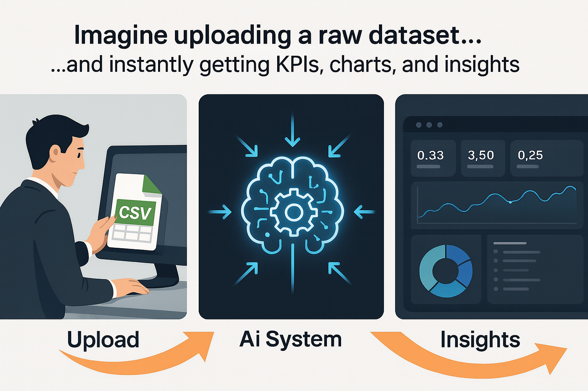
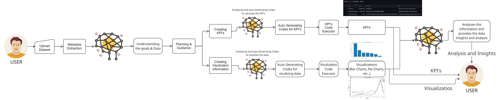

# 🤖 Autonomous Multi-Agentic system AI Data Analyst

This project is an **autonomous AI-driven data analyst system**.  
It allows users to upload a dataset (CSV, Excel, Parquet), and with **one click**, it produces:

- **Metadata extraction** (schema, column semantics, data profiling)  
- **Analysis plan generation** (KPIs, visualizations, objectives)  
- **KPI computation** (auto-generated, sandboxed Python code)  
- **Visualization generation** (safe Python code to produce plots & CSV exports)  
- **Optional insights & narratives** (future extension)  
- **Streamlit-based UI** for seamless interaction  

It effectively **automates the daily workflow of a human data analyst**.



---

## 🚀 Features
- Upload a dataset → get **KPIs + visualizations + insights** in minutes.
- **Multi-agent architecture** (Metadata Agent, Planner Agent, KPI Agent, Visualization Agent).
- **LLM-powered reasoning** (Gemini via LangChain).
- **Safe execution** of AI-generated code (sandboxed, AST-validated).
- **Explainable** (all logs and generated code are saved).
- **Extensible** (easy to add new agents, e.g., “Insight Agent”).
- **Domain-agnostic** (works on sales, finance, HR, healthcare datasets, etc.).




## 🗂 Project Structure

```
📦 Autonomous-Data-Analyst
┣ 📂 metadata/           # auto-generated metadata JSON
┣ 📂 plans/              # auto-generated analysis plans
┣ 📂 outputs/            # KPI results, viz results, figures, CSVs
┣ 📂 uploads/            # user uploaded datasets
┣ 📜 app.py              # Streamlit app (UI)
┣ 📜 orchestrator.py     # Orchestration logic (connects all modules)
┣ 📜 V\_SME\_DA\_MetadataCreator\_V1.py  # Metadata Agent
┣ 📜 V\_SME\_DA\_Planner\_V2.py          # Planner Agent
┣ 📜 V\_SME\_DA\_KPI\_Executor\_V1.py     # KPI Agent
┣ 📜 V\_SME\_DA\_Viz\_Executor\_V1.py     # Visualization Agent
┣ 📜 requirements.txt    # dependencies
┗ 📜 README.md           # this file
````

---

## 📂 File Descriptions (commented placeholders)

### `app.py`
```python
# Streamlit UI for the Autonomous Data Analyst
# - Handles file upload
# - Runs the orchestrator pipeline
# - Displays results in tabs (Overview, KPIs, Visualizations, Debug)
````

### `orchestrator.py`

```python
# Orchestrator
# - Connects all agents (Metadata → Planner → KPIs → Visualizations)
# - Captures logs
# - Aggregates results for the UI
```

### `V_SME_DA_MetadataCreator_V1.py`

```python
# Metadata Creator Agent
# - Reads uploaded dataset
# - Profiles schema, datatypes, semantics
# - Builds rich sample for LLM
# - Asks LLM for dataset + column descriptions
# - Saves metadata JSON
```

### `V_SME_DA_Planner_V2.py`

```python
# Planner Agent
# - Reads metadata
# - Asks LLM to generate JSON analysis plan
#   (KPIs, visualizations, data quality checks)
# - Validates + enriches plan with column info
# - Saves plan JSON
```

### `V_SME_DA_KPI_Executor_V1.py`

```python
# KPI Executor Agent
# - Reads analysis plan
# - For each KPI, asks LLM to generate Python function compute_kpi()
# - Validates generated code (AST, imports)
# - Runs inside sandbox
# - Saves KPI results + generated code
```

### `V_SME_DA_Viz_Executor_V1.py`

```python
# Visualization Executor Agent
# - Reads analysis plan
# - For each visualization, asks LLM for build_viz() function
# - Validates + executes code safely
# - Saves chart figures (PNG) + underlying data (CSV)
# - Logs errors/warnings if code fails
```

### `requirements.txt`

```txt
streamlit
python-dotenv
langchain-google-genai
pandas
numpy
matplotlib
pyarrow
openpyxl
```

---

## ⚙️ Installation & Setup

```bash
# Clone repository
git clone <your-repo-link>
cd Autonomous-Data-Analyst

# Create virtual environment
python -m venv venv
source venv/bin/activate   # (Linux/Mac)
venv\\Scripts\\activate    # (Windows)

# Install dependencies
pip install -r requirements.txt
```

Configure your `.env` file with your Google API key:

```
GOOGLE_API_KEY=your_key_here
```

---

## ▶️ Usage

Run the Streamlit app:

```bash
streamlit run app.py
```

1. Upload a dataset (CSV, Excel, or Parquet).
2. (Optional) Enter a business objective.
3. Click **Run Analysis**.
4. Explore results in:

   * **Overview**: dataset summary, goals, rationale
   * **KPIs**: computed KPI values with rationale
   * **Visualizations**: charts & CSV downloads
   * **Debug**: detailed logs + generated code

---

## 🏗 Architecture Overview

Agents in pipeline:

1. **Metadata Agent** → Profiles dataset & descriptions.
2. **Planner Agent** → Generates structured analysis plan.
3. **KPI Agent** → Produces KPI code & computes results.
4. **Viz Agent** → Produces visualization code & renders charts.
5. *(Future)* **Insight Agent** → Summarizes insights, anomalies, recommendations.

Execution is **autonomous**: each step calls the next and saves outputs for audit.

---

## 🌟 Future Enhancements

* Add **Insight Agent** for automated interpretation.
* Support for **SQL database connections** (not just flat files).
* Multi-user mode with saved sessions.
* Export to **PowerPoint/Word/PDF reports**.
* Integration with enterprise BI platforms (Tableau, Power BI, Looker).

---

## 📌 Key Benefits

* End-to-end automation (no manual coding required).
* Explainable results (all logs, code, JSON outputs).
* Safe execution with guardrails.
* Extensible modular design.
* Domain-agnostic (works for sales, finance, HR, healthcare, etc.).

---